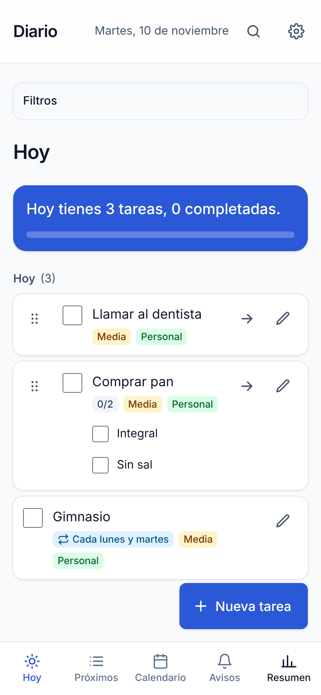
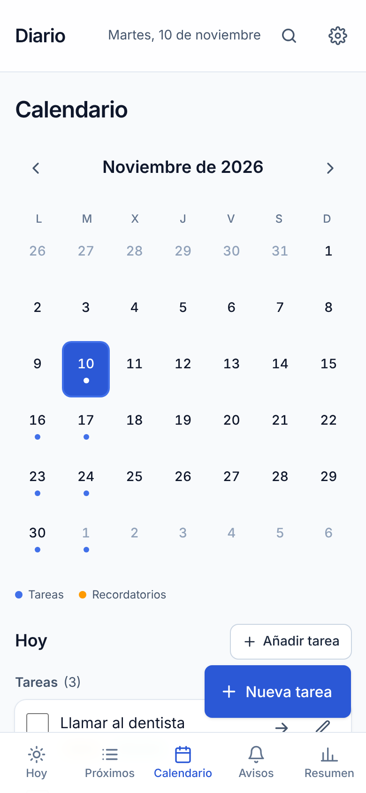
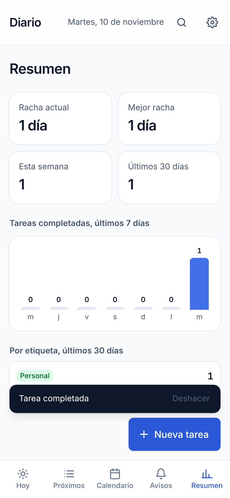
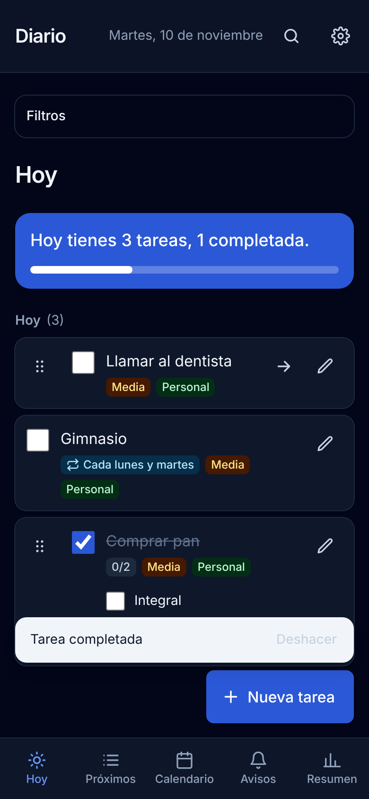

# Diario

App web de organización personal: tareas, recordatorios, calendario y estadísticas. Funciona sin conexión, guarda los datos en el propio dispositivo y se instala en el móvil como PWA.

**Demo:** https://ilyasbra.github.io/diario/

|               Hoy                |                   Calendario                   |                 Resumen                  |                Modo oscuro                 |
| :------------------------------: | :--------------------------------------------: | :--------------------------------------: | :----------------------------------------: |
|  |  |  |  |

> Las capturas se hicieron con datos de ejemplo en un viewport móvil.

## Funcionalidades

- **Tareas** con fecha, hora, prioridad y etiqueta; vistas _Hoy_ y _Próximos_.
- **Repetición**: diaria, semanal (por días) y mensual. Cada día se completa por separado.
- **Subtareas** (checklist) y **etiquetas propias** con colores.
- **Recordatorios** con fecha y notificaciones del navegador para tareas con hora.
- **Búsqueda** sin distinguir mayúsculas ni acentos, y **filtros** por etiqueta y prioridad.
- **Calendario mensual** con puntos por día.
- **Resumen**: racha actual y mejor racha, completadas por semana y por etiqueta.
- **Deshacer** al completar, borrar o mover una tarea.
- **Arrastrar** una tarea a otro día (ratón y táctil, con anuncios para lectores de pantalla).
- **6 idiomas**: español, inglés, francés, árabe (de derecha a izquierda), italiano y alemán. Usa por defecto el idioma del móvil y se puede cambiar en Ajustes.
- **Modo oscuro** (sistema, claro u oscuro, sin parpadeo al cargar).
- **Copia de seguridad** en JSON con versiones, e importación compatible con copias antiguas.
- **PWA**: instalable, funciona offline y se actualiza sola.

## Tecnología y por qué

| Pieza     | Elección                     | Motivo                                                                     |
| --------- | ---------------------------- | -------------------------------------------------------------------------- |
| UI        | React 19 + TypeScript        | Tipado estricto, sin `any`.                                                |
| Build     | Vite                         | Arranque rápido y buen soporte de PWA.                                     |
| Estilos   | Tailwind CSS v4              | Mobile-first y modo oscuro con clases.                                     |
| Datos     | Dexie (IndexedDB)            | Sin backend, con migraciones de esquema versionadas.                       |
| PWA       | vite-plugin-pwa (Workbox)    | Caché offline y actualización automática.                                  |
| Fechas    | date-fns                     | Textos en español y fechas locales.                                        |
| Arrastrar | @dnd-kit/core                | Accesible, con sensores de ratón y táctil.                                 |
| Tests     | Vitest + Testing Library     | Pruebas de comportamiento, no de implementación.                           |
| Calidad   | ESLint (+jsx-a11y), Prettier | Reglas de accesibilidad en el lint.                                        |
| CI/CD     | GitHub Actions + Pages       | Formato, lint, tipos, tests y build en cada push; despliegue desde `main`. |

## Ejecutar en local

Requisitos: Node.js 22 o superior.

```bash
npm install
npm run dev
```

Abre http://localhost:5173.

## Scripts

| Comando                 | Qué hace                              |
| ----------------------- | ------------------------------------- |
| `npm run dev`           | Servidor de desarrollo                |
| `npm run build`         | Typecheck y build de producción       |
| `npm run preview`       | Sirve el build (usa `VITE_BASE_PATH`) |
| `npm run typecheck`     | Comprueba los tipos                   |
| `npm run lint`          | ESLint sin avisos permitidos          |
| `npm run format:check`  | Comprueba el formato con Prettier     |
| `npm test`              | Ejecuta los tests                     |
| `npm run test:coverage` | Tests con cobertura                   |

## Tests

```bash
npm test            # 204 tests unitarios y de interfaz (Vitest + Testing Library)
npm run e2e         # 7 tests end-to-end (Playwright, sobre el build de producción)
```

Los primeros cubren la capa de datos (contrato común para Dexie y memoria, migraciones), la lógica pura (recurrencia, selectores, estadísticas, calendario, arrastre, búsqueda, copias de seguridad, idiomas) y los flujos de interfaz. Los e2e comprueban lo que solo se ve en un navegador real: que las tareas sobreviven a una recarga, arrastrar a otro día, deshacer, modo oscuro, detección del idioma (incluido árabe) y uso sin conexión.

La CI ejecuta ambos en cada push y no despliega si alguno falla.

## Calidad medida

Auditoría de Lighthouse sobre el build de producción, en modo móvil:

| Rendimiento | Accesibilidad | Buenas prácticas | SEO |
| :---------: | :-----------: | :--------------: | :-: |
|   79–89 ¹   |      100      |       100        | 100 |

¹ Varía entre ejecuciones por el _throttling_ de CPU de móvil. El JavaScript pesa unos 165 KB comprimido.

## Estructura

```
src/
  app/          pantalla principal, rutas y navegación
  components/   UI reutilizable (botones, iconos, diálogos)
  db/           esquema Dexie y migraciones
  features/     tasks, reminders, tags, search, calendar, stats,
                undo, backup, settings, notifications
  i18n/         idiomas, traducciones y detección del idioma
  lib/          utilidades y capa de repositorios
e2e/            tests end-to-end (Playwright)
```

Cada _feature_ agrupa sus tipos, lógica pura, estado y componentes.

## Decisiones técnicas

- **Patrón repositorio.** La interfaz `Repository` separa la app del almacenamiento. Hay dos implementaciones (Dexie y memoria) con los mismos tests de contrato, y `createRepositories.ts` es el único punto donde se elige. Cambiar a un backend no tocaría la UI.
- **Actualizaciones optimistas** con reversión si falla la escritura, en un hook común a tareas, recordatorios y etiquetas.
- **Fechas como texto local** (`yyyy-MM-dd` y `HH:mm`), sin zonas horarias: un día es un día en el dispositivo y no hay desfases al cambiar de hora.
- **Recurrencia sin duplicar filas.** Una tarea repetida se guarda una vez; cada aparición se proyecta sobre su día y se completa en `doneDates`. Las mensuales se calculan desde la fecha inicial, ajustando fines de mes (el 31 cae en el 30 o 28), sin encadenar.
- **Migraciones de Dexie** (v1–v5) con `upgrade`, de modo que los datos existentes se conservan al añadir campos.
- **Copia de seguridad versionada** (`BACKUP_VERSION`). Se valida todo al importar, se rellenan valores por defecto en copias antiguas y se restaura en orden (etiquetas, tareas, recordatorios). La app pide `storage.persist()` para que el navegador no borre los datos.
- **Idiomas sin librería.** Los textos viven en un catálogo por idioma; el de español define las claves y los demás deben tenerlas todas (lo comprueba el compilador). Los plurales usan `Intl.PluralRules` (el árabe tiene seis formas), y fechas y listas usan `Intl`, así que no hay formatos escritos a mano. Las etiquetas por defecto se traducen mientras el usuario no las renombre.
- **Árabe de derecha a izquierda.** Se usan propiedades CSS lógicas (`ms-`, `pe-`, `start-`…) y las flechas se voltean con `rtl:`. `<html lang dir>` se fija antes de pintar.
- **Idioma del móvil.** Se lee `navigator.languages`: se elige el primero disponible y, si ninguno lo está, inglés. «Automático» sigue al móvil; elegir un idioma lo fija.
- **Deshacer** con una barra temporal común, en lugar de diálogos de confirmación.
- **Accesibilidad.** Diálogos nativos `<dialog>`, reglas `jsx-a11y`, etiquetas en todos los controles, y arrastre con anuncios en español. El arrastre es un extra: todo se puede hacer también editando la tarea.
- **Modo oscuro sin parpadeo.** Un script en línea aplica la clase antes de pintar y actualiza `theme-color`.

## Próximos pasos

- Sincronización opcional entre dispositivos detrás de la misma interfaz de repositorio.
- Subtareas en tareas repetidas y arrastre de apariciones individuales.
- Cargar solo el idioma activo (hoy los seis van en el mismo paquete) para recortar peso.
- Primer día de la semana configurable (hoy siempre lunes).
